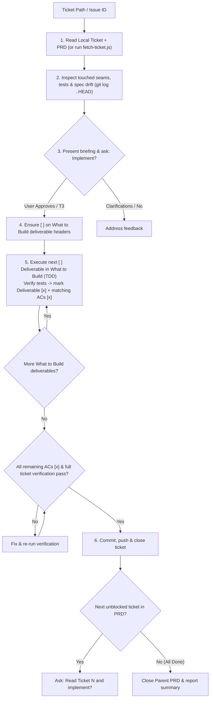

# Implement a Ticket

Execute well-specified tickets directly from their `What to Build` deliverables and `Acceptance Criteria` without creating a separate `implementation_plan.md`.

## Directives

1. **Zero Re-Planning**: NEVER generate `implementation_plan.md`; use the ticket file itself as the live execution plan.
2. **Pre-Flight Deliverable Checkboxes**: Before writing code, inspect `## What to Build` in the ticket file. If its deliverables (e.g. `### 1. <Deliverable>` or bare numbered entries) lack GFM task-list checkboxes (`- [ ]`), convert each deliverable header to `- [ ] 1. **<Deliverable>**` so mid-ticket checkpoints record completed deliverables in valid GFM syntax.
3. **Two-Layer Direct Completion (`What to Build` -> `Acceptance Criteria`)**:
   - Execute deliverables sequentially one at a time via TDD without intermediate `[/]` edits.
   - Implement and test the active deliverable, run verification commands, then toggle `- [ ]` -> `- [x]` directly on that deliverable AND on every `## Acceptance Criteria` item proven by those tests.
   - When toggling checkboxes in `What to Build` or `Acceptance Criteria`, patch ONLY the minimal unique prefix (or scoped line range) instead of echoing entire lines or paragraphs.
   - After all `## What to Build` deliverables are `[x]`, verify and check off any remaining cross-cutting `## Acceptance Criteria` items before committing.
4. **Targeted Seam Exploration**: Inspect only the codebase seams and tests relevant to the active ticket.
5. **Pre-Flight Spec Drift Check**: Before writing code, resolve the baseline commit from `Reviewed-At-Commit` in the parent PRD/ticket header, falling back to `git log -n 1 --format=%H -- <spec-dir>` if missing. When a commit SHA is found, run `git log --oneline <sha>..HEAD -- <touched-paths>` (if untracked/empty, verify touched files and symbols directly on disk). If commits landed in overlapping scope after spec review, inspect their diff and reconcile live defaults, protocols, and handlers before coding (preserve newer live behavior unless it directly contradicts a core ticket requirement; escalate to the user on semantic contradiction).
6. **Unasked-Change Guard & Considerate Porting**: Read `Change Mode` and `## Intentional Deltas` directly from the parent `PRD.md` before coding. Implement only what is explicitly specified; do NOT alter, restyle, or remove unasked behaviors or controls. When modifying, migrating, or replacing an existing file or component (including `[NEW]` deliverables declaring `Replaces: <legacy-file-path(s)>`), read the live legacy implementation and its paired assets/stylesheets/tests first. Underlying implementation layers may change per ticket (e.g. DOM to VDOM, file relocation), while all existing observable behavior, contracts, and `initial intended UXUI` default to **PRESERVE** unless explicitly listed under `INTENTIONALLY_CHANGED` in `PRD.md`.

## Workflow

1. **Fetch & Brief**:
   - Read the local ticket and parent `PRD.md` directly (specifically checking `Change Mode`, `Reviewed-At-Commit`, and `## Intentional Deltas`; for remote-only issues, run `node <skill-dir>/scripts/fetch-ticket.js <ticket-number-or-url>` to pull `.scratch/tickets/ticket_<number>.md` and `prd_<parent>.md`).
   - Inspect touched seams and tests (running `git log --oneline <sha>..HEAD -- <touched-paths>` when `Reviewed-At-Commit` is recorded, and reading live files + paired stylesheets before porting/replacing them), then present a concise briefing (`Ticket`, `Parent PRD`, `Touched Seams`, `Spec Drift` if any, `Deliverables & Acceptance Criteria`) and ask `"Implement Ticket #<number>?"` (skip confirmation when dispatched autonomously by `implement-with-subagents`).
2. **Execute & Verify**:
   - Normalize `## What to Build` deliverables to GFM task-list items (`- [ ] 1. **<Deliverable>**`) if missing.
   - Advance one deliverable at a time without intermediate `[/]` edits: write tests alongside minimal code edits, run verification, then mark the deliverable `[x]` and check off (`[x]`) satisfied `## Acceptance Criteria` items by patching only the minimal unique checkbox prefix (or scoped line range).
3. **Commit, Close & Handoff**:
   - Commit atomically: `git commit -m "<type>(<scope>): 
 (closes #<number>)"`.
   - When working against remote issues without `closes #<number>` auto-close, run `node <skill-dir>/scripts/close-ticket.js <ticket-number> --comment "Implemented and verified with unit tests."`
   - If another unblocked ticket exists in the PRD, ask `"Do you want me to read Ticket <next-number> and implement?"`.
