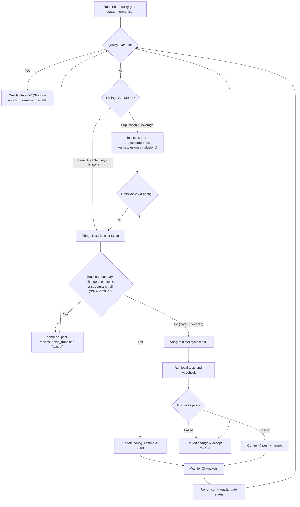

# Sonar Remediation & Quality Gate Workflows

Inspect, remediate, accept, and automate SonarQube/SonarCloud issues across files, branches, PRs, or repositories using `sonarqube-cli` (`sonar`, Docker-free over HTTPS with OS Keychain auth). For rule cookbooks, CLI/API references, and code patterns, see [REFERENCE.md](REFERENCE.md).

## Directives

1. **Quality Gate Priority**: Exit once `qualityGate.status === "OK"`. NEVER destabilize working code or churn remaining smells after the Quality Gate passes.
2. **Test Invariance**: NEVER modify unit or integration tests to satisfy Sonar suggestions. If a fix breaks any test, immediately revert the failing edit and transition to `"accept"` or `"falsepositive"`.
3. **Boundary Invariance**: NEVER refactor, extract functions, or alter serialization/cloning mechanics across sensitive boundaries (Transactions, Migrations, State stores, IPC channels, external configs); transition to `"accept"` instead.
4. **Config Before Code**: For Duplication (CPD) or Coverage failures, inspect `sonar-project.properties` (e.g. `sonar.tests`, `sonar.exclusions`, `sonar.cpd.exclusions` including `.test.tsx`/`.spec.tsx`) before editing source code.
5. **Pure Syntactic Fixes Only**: Apply fixes ONLY when 100% syntactically safe (delete unused local variable/import, fix typo, replace `Math.random()` temp suffix with `crypto.randomBytes`). If a fix requires behavioral changes or structural refactoring, transition to `"accept"`.
6. **Signature & Entrypoint Preservation**: NEVER delete, rename, or move standalone entrypoints, child processes, worker scripts, dynamic IPC/service handlers, or public API signatures.
7. **Domain Contract Preservation (`S1854`, `S1481`)**: NEVER alter returned object keys or state properties to consume an unused variable; delete the dead variable calculation instead.
8. **Issue Verification Before Status Change**: Before calling `sonar api post "/api/issues/do_transition"` (`"accept"` or `"falsepositive"`), MUST verify the exact issue key via `sonar quality-gate status`, `sonar list issues`, or `sonar api get "/api/issues/search?..."` with `statuses=OPEN`.
9. **PR Scope Parameter**: When analyzing an active PR, MUST pass `--pull-request <id>` (or `pullRequest=<id>` in `sonar api`); omitting it queries the default branch.

## Query Scope & Issue Triage

| Scope | `sonarqube-cli` (`sonar`) Command |
| :--- | :--- |
| **Quality Gate** | `sonar quality-gate status [--branch <name> \| --pull-request <id>] --format json` |
| **File** | `sonar list issues -p <projectKey> --statuses OPEN --file '<relPath>' --format json` |
| **Commit** | `git show --name-only <hash>` -> `sonar list issues -p <projectKey> --statuses OPEN --new-code --format json` |
| **Pull Request (PR)** | `sonar list issues -p <projectKey> --pull-request <id> --statuses OPEN --format json` |
| **Branch** | `sonar list issues -p <projectKey> --branch <name> --statuses OPEN --format json` |
| **Repository** | `sonar list issues -p <projectKey> --statuses OPEN --format json` |
| **Local Pre-Scan** | `sonar analyze --file <path>` / `sonar analyze secrets` / `sonar analyze dependency-risks` |

| Issue Category / Rules | Action & Constraints |
| :--- | :--- |
| **Cognitive Complexity (`S3776`)** | Transition `"accept"`. NEVER split functions solely for `S3776`; structural splits require `improve-codebase-architecture`. |
| **Deep Nesting (`S2004`)** | Transition `"accept"`. Deep nesting in UI/event/search closures is intentional design. |
| **Boundary Spreads & Cloning (`S7784`, `S7744`)** | Transition `"accept"`. Spreads `{ ...(x \|\| {}) }` guard boundaries; `structuredClone` throws on Proxies. Preserve runtime semantics. |
| **Bounded Path/File Regexes (`S8786`)** | Transition `"accept"`. Paths/filenames are OS-bounded and carry no practical ReDoS risk. |
| **Theme Contrast (`css:S7924`)** | Transition `"accept"`. Brand theme tokens override generic WCAG checks. |
| **CSP `style-src 'unsafe-inline'` (`Web:S7039`)** | Transition `"accept"` when required by React inline `style` props / virtualizers and `script-src 'self'` remains locked. |
| **Storage Boundaries (`tssecurity:S8475`)** | Transition `"accept"` on `localStorage` state/migration persistence boundaries (`Boundary Invariance`). |
| **UI Click Delegation (`S1082`)** | Delete dead no-op handlers; transition `"accept"` on intentional container click delegates when keyboard handling lives on the inner control or dialog. |
| **Duplications (CPD)** | Inspect `sonar-project.properties` test exclusions first; consolidate production duplicates only if the gate still fails. |
| **Language Smells (`S1854`, `S1481`, etc.)** | Apply minimal syntactic fix following [REFERENCE.md](REFERENCE.md). |

## Verification Loop & Batch Scripts

For large backlogs, run scripts in `<skill-dir>/scripts/`:
- `count_issues.py`: Aggregate issues by rule and component.
- `generate_plan.py`: Generate remediation plan (`request_feedback: true`).
- `generate_task.py`: Generate atomic task files (`user_facing: true`).
