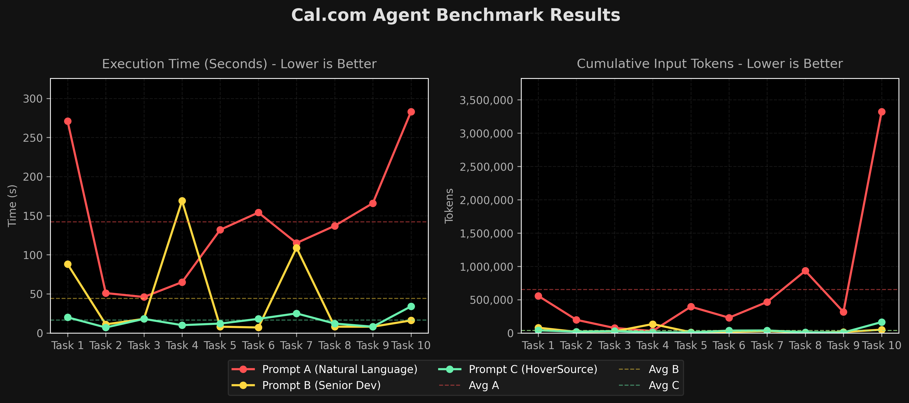
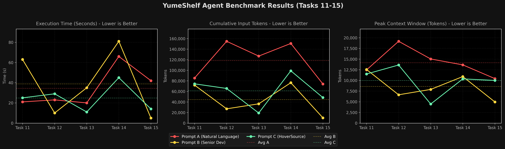

<div align="center">
  <picture>
    
  </picture>
  
  <p><b>From pixel to source file in one keystroke.</b></p>

  [](https://github.com/loerei/HoverSource/actions/workflows/ci.yml)
  [](https://opensource.org/licenses/MIT)
  [](https://github.com/loerei/HoverSource/pulls)
</div>

---

If you use AI coding agents to tweak frontend UI, you already know the pain. You try describing a button or a card with words, your agent burns half your token quota digging through the codebase, and then edits the wrong component anyway.

Hover on what you want changed, press `Alt + C`, paste to your agent.

## What It Does

- **Inspector & Design modes**: Hover over components to view file paths, component names, and CSS line numbers. Or press `Alt + X` to drag a targeting crosshair and get pixel-perfect CSS placement offsets.
- **Copy AI-ready metadata (`Alt + C` / `Alt + Shift + C`)**: Copies the exact file, line, column, computed styles, CSS origins, and parent layout context to your clipboard. Pressing `Alt + Shift + C` copies the full ancestor layer stack and an HTML skeleton of the target element.
- **Freeze state (`Alt + P`)**: Locks dropdowns, tooltips, and popovers in place so you can hover and inspect them without them vanishing.
- **CSP, Shadow DOM & Trusted Types**: Renders overlay UI inside an isolated `#hoversource-host` Shadow DOM without `innerHTML` or inline event attributes, tunnels Electron companion RPCs over persistent CDP `Runtime.addBinding` sessions, and strips `<meta>` CSP tags in the web reverse proxy. Supports Windows, macOS, and Linux.

## Benchmark: Human Language vs. HoverSource Metadata

We tested an AI coding agent (Gemini 3.5 Flash) on style modification tasks across three prompt variations (logged with [chronicle-mcp](https://github.com/loerei/chronicle-mcp)):
1. **Prompt A**: Natural language description only.
2. **Prompt B**: Manual file path and component name.
3. **Prompt C**: HoverSource clipboard metadata block.

### Benchmark 1: Cal.com Monorepo (~7,700 source files - 10 Tasks)
* Full report: [Cal.com Benchmark Report](benchmark-logs/calcom/calcom-benchmark.md)

| Metric | Natural Language (A) | File Path Only (B) | HoverSource Metadata (C) | Delta (C vs A) |
| :--- | :---: | :---: | :---: | :---: |
| **Task Achievement** | 60.0% (6/10) | 100.0% (10/10) | 100.0% (10/10) | **+66.7%** |
| **Avg Agent Steps** | 65.6 | 18.0 | 17.1 | **-73.9%** |
| **Avg Tool Calls** | 30.5 | 6.5 | 5.9 | **-80.7%** |
| **Avg Execution Time** | 142.0s | 44.2s | 16.4s | **-88.5%** (8.7x faster) |
| **Avg Cumulative Input Tokens** | 651,681 | 37,858 | 35,733 | **-94.5%** (18.2x fewer tokens) |
| **Avg Peak Context Window** | 28,257 | 7,372 | 6,486 | **-77.0%** |



### Benchmark 2: YumeShelf Electron App (~200 source files - 5 Tasks)
* Full report: [YumeShelf Benchmark Report](benchmark-logs/yumeshelf/yumeshelf-benchmark.md)

| Metric | Natural Language (A) | File Path Only (B) | HoverSource Metadata (C) | Delta (C vs A) |
| :--- | :---: | :---: | :---: | :---: |
| **Task Achievement** | 100.0% (5/5) | 100.0% (5/5) | 100.0% (5/5) | - |
| **Avg Agent Steps** | 34.4 | 22.0 | 26.0 | **-24.4%** |
| **Avg Tool Calls** | 15.2 | 8.8 | 11.0 | **-27.6%** |
| **Avg Execution Time** | 34.4s | 38.8s | 24.8s | **-27.9%** (1.4x faster) |
| **Avg Cumulative Input Tokens** | 118,354 | 44,382 | 61,255 | **-48.2%** (1.9x fewer tokens) |
| **Avg Peak Context Window** | 14,140 | 8,589 | 9,984 | **-29.4%** |



## Modes

Toggle modes at any time with `Alt + X`.

### 1. Inspector Mode (Default)
For debugging or modifying existing UI elements.
- Hover over an element to see its bounding box, file path, component name, CSS origin lines, and layout constraints.
- Press `Alt + C` to copy component metadata.

### 2. Design Mode
For positioning new UI elements (badges, cards, popovers, tooltips) relative to existing elements.
- Drag the crosshair to snap against nearby element edges and measure pixel offsets (`dX`, `dY`).
- Press `Alt + C` to copy layout specs, anchor selectors, and ready-to-use CSS positioning blocks (`top`, `left`, `white-space`).

## Framework Support

| Metadata Field | React | Vue | Svelte | Angular | SolidJS | Preact | Astro | Vanilla |
| :--- | :--- | :--- | :--- | :--- | :--- | :--- | :--- | :--- |
| **Component Name** | Resolved | Resolved | Resolved | Resolved | Resolved | Resolved | Resolved | Fallback (DOM tag) |
| **File Path** | Resolved | Resolved | Resolved | Unresolved / Resolved\* | Resolved | Resolved | Resolved | Resolved\*\* |
| **Line Number** | Resolved | None / Resolved\* | Resolved | None / Resolved\* | Resolved | Resolved | Resolved | Resolved\*\* |
| **Column Number** | Resolved | None / Resolved\* | Resolved | None / Resolved\* | Resolved | Resolved | Resolved | Resolved\*\* |
| **Tag Name & Classes** | Resolved | Resolved | Resolved | Resolved | Resolved | Resolved | Resolved | Resolved |

\* *Vue and Angular require template tagging (`hs install --vue` or `hs install --angular`) for line and column numbers. Other frameworks resolve out of the box in development mode.*

\*\* *Vanilla JS/TS resolves dynamic elements via V8 stack traces (`document.createElement`, `innerHTML`) and static template elements (`src/index.html`, `index.html`) via in-memory AST mapping.*

### Next.js & React Server Components (RSC)
For Next.js 14+ projects, HoverSource temporarily patches React development runtimes on disk to resolve source locations for SSR and RSC components. All patched files restore automatically on shutdown.

### Vanilla JS/TS
1. **Dynamic DOM Elements**: Captures active V8 call stacks on `document.createElement` and `innerHTML` to map created elements back to their script files (e.g. `src/renderer/game-cards.ts:29:18`).
2. **Static HTML Elements**: Scans template HTML files (`src/index.html`, `index.html`) on startup to match static tags, IDs, classes, and attributes with 0ms latency.
3. **Zero-Network & CSP Immune**: Runs 100% in-memory without making network requests, working seamlessly in Electron apps with strict Content Security Policies.

## Quickstart

Install globally:

```bash
npm install -g hoversource
```

Or run directly with npx:

```bash
npx hoversource start
```

Run inside your project root:

```bash
hs start
```

HoverSource detects your project type from `package.json`, starts your dev server, and attaches the overlay. `hs start` runs `npm run start`, or you can pass any script name:

```bash
hs dev     # runs npm run dev
hs serve   # runs npm run serve
```

### Web app with existing server

If your dev server is already running, attach with a proxy:

```bash
hs --target=http://localhost:5173
```

HoverSource opens your app in your default browser. Hover any element and press `Alt + C`.

### Electron Apps

For Electron apps, enable the remote debugging port in your main process before `app.whenReady()`:

```typescript
import { app } from 'electron';

if (!app.isPackaged) {
  let port = '9222';
  const extraArgs = process.env.ELECTRON_EXTRA_LAUNCH_ARGS;
  if (extraArgs) {
    const match = extraArgs.match(/--remote-debugging-port=(\d+)/);
    if (match) port = match[1];
  }
  if (!app.commandLine.hasSwitch('remote-debugging-port')) {
    app.commandLine.appendSwitch('remote-debugging-port', port);
  }
}

app.whenReady().then(() => {
  // ...
});
```

## Commands & Flags

### Commands

| Command | Description |
|---|---|
| `hs start` / `hs dev` / `hs serve` | Start project dev server and attach HoverSource (web proxy or Electron CDP) |
| `hs dashboard` / `hs -d` | Open the companion configuration dashboard directly |
| `hs config [inspect\|set\|reset\|delete]` | Inspect or update `.hoversourcerc` (`--global`, `--json`, `--dry-run`) |
| `hs install [--vue\|--angular\|--solid]` | Install framework template tagging plugins |

### Flags

| Flag | Default | Description |
|---|---|---|
| `--port=N` / `-p N` | auto (`7300+`) | Companion server port |
| `--proxy-port=N` | target port + 10000 | Proxy port in web mode |
| `--dev-port=N` | auto | Override detected dev server port |
| `--debug-port=N` | `9222+` | CDP debug port in Electron mode |
| `--auto-resolve` | `false` | Terminate non-zombie processes occupying Electron dev port |
| `--https` | `false` | Serve web proxy over local HTTPS using HoverSource Root CA |
| `--dashboard` / `-d` | off | Open config dashboard on start (or standalone) |

## Clipboard Output

When you press `Alt + C`, HoverSource copies a Markdown block to your clipboard.

### Single Element (`Alt + C`)

```markdown
* **Component**: `ChatThreadView`
* **Element**: `button.persona-card__action-button` ➔ [Source: `workspace.css` (Line: 60, Column: 1)]
* **File Path**: `src/features/chat/ChatThreadView.tsx` (Line: 659, Column: 5)
* **Framework**: React
* **Dimensions**: 1485x1044
* **Key Styles**:
  - Color: `rgb(255, 255, 255)`
  - Background: `rgba(0, 0, 0, 0)`
  - Box Shadow: `none`
  - Margin: `0px` | Padding: `20px 44px 26px`
  - Display: `flex` (direction: column)
* **Parent Styles**:
  - `div.chat-thread__body` ➔ `mask-image: linear-gradient(rgba(0,0,0,0) 0%, rgb(0,0,0) 10px)` ➔ [Source: `workspace.css` (Line: 793, Column: 3)]
  - `div.chat-thread__body` ➔ `overflow-y: hidden`
  - `section.chat-thread` ➔ `overflow-y: hidden`
* **Layout Constraints**:
  - `flex: 1 1 0%`
  - `min-height: 0`
* **Source Comments**:
  - `Renders the scrollable message list for the active chat thread.`
* **Source Attributes**:
  - `data-testid="chat-thread-body"`
```

### Multi-Layer Stack (`Alt + Shift + C`)

```markdown
Found 3 layer(s), ordered from leaf (Layer 1) to root:

#### Layer 1/3: `div` (div)
* **Component**: `div`
* **Element**: `div.game-card.favorited`
* **File Path**: `src/components/GameCard.tsx` (Line: 12, Column: 4)
* **Framework**: React
* **Dimensions**: 213x252
* **Key Styles**:
  - Color: `rgb(255, 255, 255)`
  - Background: `rgb(42, 42, 42)`
  - Box Shadow: `rgba(255, 215, 0, 0.15) 0px 6px 25px 0px`
  - Margin: `0px` | Padding: `20px`
  - Display: `flex` (direction: column)
* **Layout Constraints**:
  - `position: relative`
  - `display: flex`

### Target Element HTML Structure (Layer 1)
```html
<div class="game-card favorited">
  <div class="game-icon">
    <svg></svg>
  </div>
  <div class="game-status"></div>
</div>
```
```

### Design Placement Metadata (`Alt + C` in Design Mode)

```markdown
* **Component**: `Card`
* **Element**: `div#login-card.card`
* **File Path**: `src/components/LoginCard.tsx` (Line: 122, Column: 5)
* **Framework**: React
* **Horizontal Anchor**:
  - Selector: `div#login-card.card`
  - Boundary: `Right-Edge`
  - Crosshair distance: `+123px`
* **Vertical Anchor**:
  - Selector: `div#login-card.card`
  - Boundary: `Top-Edge`
  - Crosshair distance: `+40px`

#### Layout Context
* **Anchor Element**: `div#login-card.card` (display: block)
* **Direct Parent of Anchor**: `div.sandbox-container` (display: flex)
* **USE THIS CSS**:
```css
position: absolute;
left: calc(100% + 123px);
top: 40px;
white-space: nowrap;
```
```

## Screenshots

<p align="center">
  
  
</p>

<p align="center">
  
</p>

<p align="center">
  
</p>

## License

MIT

a star on GitHub would be nice if you find it useful.
